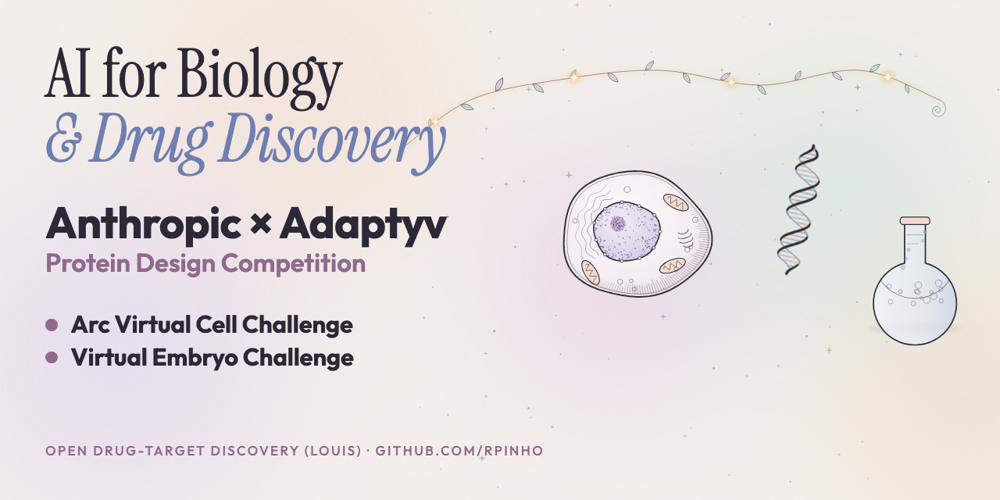

# ai-biology

**AI for Biology & Drug Discovery.**

Everything I've run on biology with AI agents, in one place. Three sponsored challenges, two tools, and bug reports for scientists' published software. Each section links to the code and results, says how it was checked, and says where a result is still a candidate.

I did my PhD in computational biology (gene regulatory networks, Marcus Feldman's lab at Stanford). I came back to it in 2026 with AI agents. Biology has been the hardest of the three fields I've worked in this year, after math and physics. Why, in the [field retro](RETRO.md).

Sister hubs: [math](https://github.com/rpinho/math-certificates) · [physics](https://github.com/rpinho/ai-physics) · [astronomy](https://github.com/rpinho/planet-hunt)

## Why it's laid out like this

Brian Armstrong wrote on November 7 that publicly funded science should work like open source: every experiment as a repo anyone can fork, rerun and fix, with replication rewarded like new papers ([post](https://x.com/brian_armstrong/status/2119150702446420027)). His point about AI matches what I keep hitting. Agents make finding things cheaper, so the bottleneck moves to checking them, and in biology checking usually means a wet lab.

So each result here ships with what you need to rerun it and a separate referee's verdict. A referee here is a different agent that rebuilds the claim from the primary source on a fresh clone, without the finder's code. Only CONFIRMED, HOLDS and HOLDS WITH CAVEATS results are listed, and the caveats stay attached.

## Challenges

| Challenge | What I entered | Status | Code |
|---|---|---|---|
| **Anthropic × Adaptyv Protein Design Competition** ([competition](https://proteinbase.com/competitions/anthropic-adaptyv-2026)) | Entries for Challenges 3, 4 and 5. The competition measures submitted entries in an automated lab and publishes every measurement, failures included. | Submitted; lab results not out at the time of writing | [adaptyv-challenges](https://github.com/rpinho/adaptyv-challenges) |
| **Arc Institute Virtual Cell Challenge 2026** ([site](https://virtualcellchallenge.org/)) | Predicting CRISPRi knockdown effects in an unseen cell type. Best official validation 0.16438, about rank 463 of 1,580 when recorded. The final phase closed November 5 and its scores are hidden. | Closed; [retro](https://github.com/rpinho/virtual-cell-challenge/blob/main/RETRO.md) published | [virtual-cell-challenge](https://github.com/rpinho/virtual-cell-challenge) |
| **Virtual Embryo Challenge** ([site](https://virtualembryo.ai/challenge)) | Community tools and an Agent Team entry: stage-window checks against public atlases, and synthetic tutorials on choosing what to submit and on building local proxy boards. No challenge data or results are published here. | Scoring closed; results December 11 | [ve-community](https://github.com/rpinho/ve-community) |

## Tools and older work

| Repo | What it is |
|---|---|
| [louis](https://github.com/rpinho/louis) | Pick an autoimmune disease, get trust-ranked candidate CD4+ T-cell targets, built on the Marson/Pritchard genome-scale T-cell Perturb-seq. MCP server, skill or Slack bot. Hypothesis generation, not a clinical claim. |
| [autoregulation](https://github.com/rpinho/autoregulation) | My PhD code: stability of Boolean gene regulatory networks depends on the sign of self-regulation. Python 2, kept as a record. Published (PLoS Comput Biol 2014; PLoS ONE 2012, 2015). |

## Friends' software: what was asked, what we found, how it was checked

Scientists I know publish code with their papers. I asked each of them whether a bug hunt would be useful, ran one on the public repository at a pinned commit, had a separate referee reproduce every finding from scratch, and sent them the report. Everything below has been sent to the person named. Their replies stay private; only what went out is here.

### Manuel Irimia — ExOrthist and vast-tools

- **Who:** [Manuel Irimia](https://www.crg.eu/en/programmes-groups/irimia-lab), ICREA at CRG and UPF, Barcelona. [ExOrthist](https://github.com/biocorecrg/ExOrthist) (Márquez et al., *Genome Biology* 2021, [doi:10.1186/s13059-021-02441-9](https://doi.org/10.1186/s13059-021-02441-9)) infers exon orthologies; [vast-tools](https://github.com/vastgroup/vast-tools) quantifies alternative splicing.
- **Asked:** he said yes to a report, so the hunt ran on public master, pinned at `83185dc` (ExOrthist) and `5598e1f` (vast-tools).
- **Found:** 32 bugs in ExOrthist (23 plus 9 minor) and 6 in vast-tools (4 plus 2 minor). Examples: a transcript-first GTF writes transcript IDs into gene slots; minus-strand CDS records in ascending order change the translated protein and reverse exon numbering; exon end positions include one residue of the next exon. Each has a `git apply` patch and a before/after repro. One candidate was judged intended behaviour and dropped.
- **Checked:** a separate referee reproduced all of them independently on pristine pinned clones — [ExOrthist A/B](friends/manuel-irimia-exorthist-vast-tools/referee/exorthist-a-b/VERDICTS.md), [ExOrthist C/D](friends/manuel-irimia-exorthist-vast-tools/referee/exorthist-c-d/VERDICTS.md), [vast-tools](friends/manuel-irimia-exorthist-vast-tools/referee/vast-tools/VERDICTS.md).
- **Separately, M011:** the released ExOrthist membership score disagrees with the formula printed in the paper's Methods on 18 of 1,108 rows of the official test (0.86 where the formula gives exactly 1). HOLDS WITH CAVEATS — the caveat is that a second, disclosed defect in the gene universe means the literal paper formula still fails on 30 rows after the fix. [Claim, report and verdict](friends/manuel-irimia-exorthist-vast-tools/m011-membership-score/).
- **Code and results:** [report, patches and repros](friends/manuel-irimia-exorthist-vast-tools/).

### Hugo Fernandes — pyglmnet

- **Who:** [Hugo L. Fernandes](https://scholar.google.com/citations?user=0Yy0dJkAAAAJ), computational neuroscience. [pyglmnet](https://github.com/glm-tools/pyglmnet) is the elastic-net GLM package he contributed to.
- **Asked:** he said that if we found things there, we could open PRs.
- **Found and upstreamed:** three fixes, each with a test that fails on master and passes with the fix — [PR #399](https://github.com/glm-tools/pyglmnet/pull/399) (Bernoulli log-likelihood is NaN at probabilities 0 and 1, and overflows for large logits), [PR #400](https://github.com/glm-tools/pyglmnet/pull/400) (gamma deviance and pseudo-R² omit the saturated log-likelihood; the fixed value matches statsmodels to 1e-15), [PR #401](https://github.com/glm-tools/pyglmnet/pull/401) (`simulate_glm(sample=True)` returns `exp(mu)` instead of gamma draws). All three are open, not merged.
- **Checked:** a separate referee's [verdicts](friends/hugo-fernandes-pyglmnet/referee/VERDICTS.md), plus a full-suite [verification log](friends/hugo-fernandes-pyglmnet/VERIFY.txt) and [a review](friends/hugo-fernandes-pyglmnet/REVIEW.md) that sent the first draft back three times. Two further findings were left out because an existing open PR already covers one and the other is intended behaviour.
- **Code:** [PR texts, patches and the verification script](friends/hugo-fernandes-pyglmnet/).
- Hugo's optimization results are in the [math hub](https://github.com/rpinho/math-certificates), because they are exact optima rather than biology.

### Kris Sankaran — R packages

- **Who:** [Kris Sankaran](https://krisrs1128.github.io/LSLab/), statistics, UW-Madison. Packages: [multimedia](https://cran.r-project.org/package=multimedia), [structSSI](https://cran.r-project.org/package=structSSI), [miniLNM](https://github.com/krisrs1128/miniLNM).
- **Found:** 7 bugs (6 plus 1 minor). The top three: `multimedia`'s Gaussian glmnet and random-forest samplers pass a variance where `rnorm` expects a standard deviation, so simulated noise is squared; `structSSI`'s GBH gives every result the name of the first sorted hypothesis; `miniLNM` filters the design matrix by variable name and silently drops the intercept.
- **Checked:** separate referee, CONFIRMED, on pinned source and the installed CRAN versions. Verdicts and repros stay in the bug report sent to him; this hub links the summary rather than republishing his packages' sources.
- **Sent:** November 6, with patches and before/after output.

### Gavin Sherlock — GO::TermFinder

- **Who:** [Gavin Sherlock](https://sherlocklab.stanford.edu/), Stanford Genetics. [GO::TermFinder](https://metacpan.org/dist/GO-TermFinder) 0.86 (Boyle et al., *Bioinformatics* 2004, [doi:10.1093/bioinformatics/bth456](https://doi.org/10.1093/bioinformatics/bth456)).
- **Found:** 6 bugs (4 plus 2 minor). The top one: NOT-qualified GAF annotations are counted as positive evidence, which inflates enrichment for exactly the genes an annotator said the term does not apply to. Three further findings are already fixed in the Princeton fork and are named but not counted.
- **Checked:** separate referee on a fresh CPAN build.
- **Sent:** November 7, first contact, with an all-fixes patch.

### Marcel Salathé — COVID-Twitter-BERT and lab repos

- **Who:** [Marcel Salathé](https://people.epfl.ch/marcel.salathe), EPFL Digital Epidemiology. [COVID-Twitter-BERT](https://github.com/digitalepidemiologylab/covid-twitter-bert) ([arXiv:2005.07503](https://arxiv.org/abs/2005.07503)) and two other lab repositories.
- **Found:** 5 bugs (3 plus 2 minor). The top one: a single over-length line makes the whole `run_predict.py` batch fail, so an ordinary mixed text file cannot be scored. Numeric TSV labels crash fine-tuning data generation before any record is written. One further finding is inherited from upstream and is named but not counted.
- **Checked:** separate referee on independently downloaded pinned source, [verdicts](friends/salathe-covid-twitter-bert/VERDICTS.md).
- **Sent:** November 7, first contact.

### Victor Garcia — the NK-CTL model and a codon-rate preprint

- **Who:** Victor Garcia, mathematical modelling of immune responses and evolution, Switzerland. Garcia, Bonhoeffer and Fu, *J. Theor. Biol.* 2020, [doi:10.1016/j.jtbi.2020.110185](https://doi.org/10.1016/j.jtbi.2020.110185), with its R script on Figshare; the 2025 codon-rate preprint, [doi:10.1101/2025.06.03.657573](https://doi.org/10.1101/2025.06.03.657573).
- **Found:**
  - **The model (HOLDS, three separate referees):** global convergence and the exact bistability region of the NK-CTL model. [Note, checker and verdicts](friends/victor-garcia-nk-ctl/nk-ctl-note/).
  - **The script (CONFIRMED WITH CAVEATS):** line 35 of the released R script uses `hg + T²` where equations 22 and 76 use `hg + T`. At σ = 1000, k = 10⁻⁵, c = 0.001 that change creates a stable tumor state the printed model doesn't have. The caveat: the paper doesn't pin σ and k for Fig. A2, and the corrected model can still be bistable elsewhere. [Bug, repro and verdict](friends/victor-garcia-nk-ctl/script-line-35/).
  - **The preprint (HOLDS):** NMDS stress drops from 34.8 to 16.97 for Fig 2B and from 23.4 to 13.48 for Fig 2C, on the same data and the same objective. [Fig 2B](friends/victor-garcia-nk-ctl/nmds-fig2b/) · [Fig 2C](friends/victor-garcia-nk-ctl/nmds-fig2c/).
  - **A later-data test of the Danish forecast (HOLDS WITH CAVEATS).** [Claim and verdict](friends/victor-garcia-nk-ctl/danish-forecast/).
- **Sent:** November 2, 5 and 6.

### Not in this hub

- Aires Ferreira (KITE) is condensed-matter physics and sits in the [physics hub](https://github.com/rpinho/ai-physics); Hugo's optimization work, José Bento's optimization results, Oliveira e Silva's analysis and Marco Sampaio's benchmark are in the [math hub](https://github.com/rpinho/math-certificates).
- Results that were never sent to the person they concern are not here, in any field.

## How this was run

All of it with AI agents under a bounded harness, [rstack](https://github.com/rpinho/rstack): frozen tests before the first result, the scoring kept away from the agent doing the searching, and prior art reproduced with a command rather than quoted. The biology-specific lesson is in the [retro](RETRO.md): the agents were not the constraint; the data was.

## References

Nothing here is from scratch. Each repository carries its own references; this list covers the hub.

- Brian Armstrong, [publicly funded science as open source](https://x.com/brian_armstrong/status/2119150702446420027), November 7, 2026.
- Arc Institute, [Virtual Cell Challenge](https://virtualcellchallenge.org/).
- Anthropic and Adaptyv Bio, [the protein design competition](https://proteinbase.com/competitions/anthropic-adaptyv-2026), including its public release of every measurement.
- [Virtual Embryo Challenge](https://virtualembryo.ai/challenge).
- Márquez et al., ExOrthist, *Genome Biology* 2021, [doi:10.1186/s13059-021-02441-9](https://doi.org/10.1186/s13059-021-02441-9).
- Tapial et al., vast-tools / VastDB, *Genome Research* 2017, [doi:10.1101/gr.220962.117](https://doi.org/10.1101/gr.220962.117).
- Boyle et al., GO::TermFinder, *Bioinformatics* 2004, [doi:10.1093/bioinformatics/bth456](https://doi.org/10.1093/bioinformatics/bth456).
- Müller, Salathé and Kummervold, COVID-Twitter-BERT, [arXiv:2005.07503](https://arxiv.org/abs/2005.07503).
- Garcia, Bonhoeffer and Fu, *J. Theor. Biol.* 2020, [doi:10.1016/j.jtbi.2020.110185](https://doi.org/10.1016/j.jtbi.2020.110185).
- pyglmnet, [glm-tools/pyglmnet](https://github.com/glm-tools/pyglmnet); multimedia, structSSI and miniLNM on CRAN.
- Anthropic Economics, [AI for scientific discovery: how researchers use Claude](https://www.anthropic.com/research/how-researchers-use-claude), November 5, 2026 — the per-field numbers the retro uses.
- Pinho, Garcia and Feldman, *PLOS ONE* 2015, [doi:10.1371/journal.pone.0119972](https://doi.org/10.1371/journal.pone.0119972); Pinho, Borenstein and Feldman, *PLoS Comput Biol* 2014, [doi:10.1371/journal.pcbi.1003595](https://doi.org/10.1371/journal.pcbi.1003595).

Thanks to Arc Institute, to Adaptyv Bio and Anthropic for funding experimental validation, and to the scientists above for letting an outsider's agents read their code.
