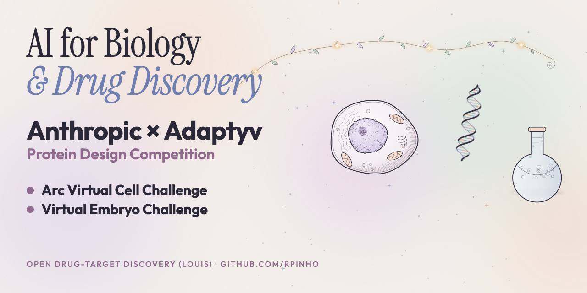

# ai-biology

**AI for Biology & Drug Discovery.**

Everything I've run on biology with AI agents, in one place. Three sponsored challenges, two tools, and bug reports for scientists' published software. Each section links to the code and results, says how it was checked, and says where a result is still a candidate.

My PhD was on the evolution of gene regulatory networks, in Marcus Feldman's lab at Stanford: evolutionary biology and population genetics. I came back to it in 2026 with AI agents. Biology has been the hardest of the three fields I've worked in this year, after math and physics. Why, in the [field retro](RETRO.md).

Every result in one file, with its claim or bug report, checks and verdict copied from the result folders: [PAPER.md](PAPER.md).

Sister hubs: [math](https://github.com/rpinho/math-certificates) · [physics](https://github.com/rpinho/ai-physics) · [astronomy](https://github.com/rpinho/planet-hunt)

## Why it's laid out like this

Brian Armstrong wrote on November 7 that publicly funded science should work like open source: every experiment as a repo anyone can fork, rerun and fix, with replication rewarded like new papers ([post](https://x.com/brian_armstrong/status/2119150702446420027)). His point about AI matches what I keep hitting. Agents make finding things cheaper, so the bottleneck moves to checking them, and in biology checking usually means a wet lab.

So each result here ships with what you need to rerun it and a separate referee's verdict. A referee here is a different agent that rebuilds the claim from the primary source on a fresh clone, without the finder's code. Only CONFIRMED, HOLDS and HOLDS WITH CAVEATS results are listed, and the caveats stay attached.

## Challenges

| Challenge | What I entered | Status | Code |
|---|---|---|---|
| **Anthropic × Adaptyv Protein Design Competition** ([competition](https://proteinbase.com/competitions/anthropic-adaptyv-2026)) | Entries for Challenges 3, 4 and 5. The competition measures submitted entries in an automated lab and publishes every measurement, failures included. | Submitted; lab results not out at the time of writing | [adaptyv-challenges](https://github.com/rpinho/adaptyv-challenges) |
| **Arc Institute Virtual Cell Challenge 2026** ([site](https://virtualcellchallenge.org/)) | Predicting CRISPRi knockdown effects in an unseen cell type. Best official validation 0.16438, about rank 463 of 1,580 when recorded. The final phase closed November 5 and its scores are hidden. | Closed; [retro](https://github.com/rpinho/virtual-cell-challenge/blob/main/RETRO.md) published | [virtual-cell-challenge](https://github.com/rpinho/virtual-cell-challenge) |
| **Virtual Embryo Challenge** ([site](https://virtualembryo.ai/challenge)) | Community tools and an Agent Team entry: stage-window checks against public atlases, and synthetic tutorials on choosing what to submit and on building local proxy boards. No challenge data or results are published here. | Scoring closed; results December 11 | [virtual-embryo-community](https://github.com/rpinho/virtual-embryo-community) |

## Tools and older work

| Repo | What it is |
|---|---|
| [louis](https://github.com/rpinho/louis) | Pick an autoimmune disease, get trust-ranked candidate CD4+ T-cell targets, built on the Marson/Pritchard genome-scale T-cell Perturb-seq. MCP server, skill or Slack bot. Hypothesis generation, not a clinical claim. |
| [autoregulation](https://github.com/rpinho/autoregulation) | My PhD code: stability of Boolean gene regulatory networks depends on the sign of self-regulation. Python 2, kept as a record. Published (PLoS Comput Biol 2014; PLoS ONE 2012, 2015). |

## Friends' software: what was asked, what I found, how it was checked

Scientists I know publish code with their papers. I asked each of them whether a bug hunt would be useful, ran one on the public repository at a pinned commit, had a separate referee reproduce every finding from scratch, and sent them the report. Everything below has been sent to the person named. Their replies stay private; only what went out is here.

### Manuel Irimia — ExOrthist and vast-tools

- **Who:** [Manuel Irimia](https://www.crg.eu/en/programmes-groups/irimia-lab), ICREA at CRG and UPF, Barcelona. [ExOrthist](https://github.com/biocorecrg/ExOrthist) (Márquez et al., *Genome Biology* 2021, [doi:10.1186/s13059-021-02441-9](https://doi.org/10.1186/s13059-021-02441-9)) infers exon orthologies; [vast-tools](https://github.com/vastgroup/vast-tools) quantifies alternative splicing.
- **Asked:** he said yes to a report, so the hunt ran on public master, pinned at `83185dc` (ExOrthist) and `5598e1f` (vast-tools).
- **Found:** 32 bugs in ExOrthist (23 plus 9 minor) and 6 in vast-tools (4 plus 2 minor). Examples: a transcript-first GTF writes transcript IDs into gene slots; minus-strand CDS records in ascending order change the translated protein and reverse exon numbering; exon end positions include one residue of the next exon. Each has a `git apply` patch and a before/after repro. One candidate was judged intended behaviour and dropped.
- **Checked:** a separate referee reproduced all of them independently on pristine pinned clones — [ExOrthist A/B](friends/manuel-irimia-exorthist-vast-tools/referee/exorthist-a-b/VERDICTS.md), [ExOrthist C/D](friends/manuel-irimia-exorthist-vast-tools/referee/exorthist-c-d/VERDICTS.md), [vast-tools](friends/manuel-irimia-exorthist-vast-tools/referee/vast-tools/VERDICTS.md).
- **Separately, M011:** the released ExOrthist membership score disagrees with the formula printed in the paper's Methods on 18 of 1,108 rows of the official test (0.86 where the formula gives exactly 1). HOLDS WITH CAVEATS — the caveat is that a second, disclosed defect in the gene universe means the literal paper formula still fails on 30 rows after the fix. [Claim, report and verdict](friends/manuel-irimia-exorthist-vast-tools/m011-membership-score/).
- **Code and results:** [report, patches and repros](friends/manuel-irimia-exorthist-vast-tools/).

### Hugo Fernandes — pyglmnet

- **Who:** [Hugo L. Fernandes](https://scholar.google.com/citations?user=0Yy0dJkAAAAJ), computational neuroscience. [pyglmnet](https://github.com/glm-tools/pyglmnet) is the elastic-net GLM package he contributed to.
- **Asked:** he said that if I found things there, I could open PRs.
- **Found and upstreamed:** three fixes, each with a test that fails on master and passes with the fix — [PR #399](https://github.com/glm-tools/pyglmnet/pull/399) (Bernoulli log-likelihood is NaN at probabilities 0 and 1, and overflows for large logits), [PR #400](https://github.com/glm-tools/pyglmnet/pull/400) (gamma deviance and pseudo-R² omit the saturated log-likelihood; the fixed value matches statsmodels to 1e-15), [PR #401](https://github.com/glm-tools/pyglmnet/pull/401) (`simulate_glm(sample=True)` returns `exp(mu)` instead of gamma draws). [#399](https://github.com/glm-tools/pyglmnet/pull/399) and [#401](https://github.com/glm-tools/pyglmnet/pull/401) were merged on 2026-11-08; #400 is still open.
- **Checked:** a separate referee's [verdicts](https://github.com/rpinho/fixing-research-software/blob/main/glm-tools-pyglmnet/referee/VERDICTS.md), plus a full-suite [verification log](https://github.com/rpinho/fixing-research-software/blob/main/glm-tools-pyglmnet/VERIFY.txt) and [a review](https://github.com/rpinho/fixing-research-software/blob/main/glm-tools-pyglmnet/REVIEW.md) that sent the first draft back three times. Two further findings were left out because an existing open PR already covers one and the other is intended behaviour.
- **Code:** [PR texts, patches and the verification script](https://github.com/rpinho/fixing-research-software/tree/main/glm-tools-pyglmnet).
- Hugo's optimization results are in the [math hub](https://github.com/rpinho/math-certificates), because they are exact optima rather than biology.

### Kris Sankaran — R packages

- **Who:** [Kris Sankaran](https://krisrs1128.github.io/LSLab/), statistics, UW-Madison. Packages: [multimedia](https://cran.r-project.org/package=multimedia), [structSSI](https://cran.r-project.org/package=structSSI), [miniLNM](https://github.com/krisrs1128/miniLNM).
- **Found:** 7 bugs (6 plus 1 minor). The top three: `multimedia`'s Gaussian glmnet and random-forest samplers pass a variance where `rnorm` expects a standard deviation, so simulated noise is squared; `structSSI`'s GBH gives every result the name of the first sorted hypothesis; `miniLNM` filters the design matrix by variable name and silently drops the intercept.
- **Checked:** separate referee, CONFIRMED, on pinned source and the installed CRAN versions. Verdicts and repros stay in the bug report sent to him; this hub links the summary rather than republishing his packages' sources.
- **Sent:** November 6, with patches and before/after output.

### Gavin Sherlock — GO::TermFinder

- **Who:** [Gavin Sherlock](https://sherlocklab.stanford.edu/), Stanford Genetics. [GO::TermFinder](https://metacpan.org/dist/GO-TermFinder) 0.86 (Boyle et al., *Bioinformatics* 2004, [doi:10.1093/bioinformatics/bth456](https://doi.org/10.1093/bioinformatics/bth456)).
- **Found:** 6 bugs (4 plus 2 minor). The top one: NOT-qualified GAF annotations are counted as positive evidence, which inflates enrichment for exactly the genes an annotator said the term does not apply to. Three further findings are already fixed in the Princeton fork and are named but not counted.
- **Checked:** separate referee on a fresh CPAN build.
- **Sent:** November 7, first contact, with an all-fixes patch.

### Marcel Salathé — COVID-Twitter-BERT and lab repos

- **Who:** [Marcel Salathé](https://people.epfl.ch/marcel.salathe), EPFL Digital Epidemiology. [COVID-Twitter-BERT](https://github.com/digitalepidemiologylab/covid-twitter-bert) ([arXiv:2005.07503](https://arxiv.org/abs/2005.07503)) and two other lab repositories.
- **Found:** 5 bugs (3 plus 2 minor). The top one: a single over-length line makes the whole `run_predict.py` batch fail, so an ordinary mixed text file cannot be scored. Numeric TSV labels crash fine-tuning data generation before any record is written. One further finding is inherited from upstream and is named but not counted.
- **Checked:** separate referee on independently downloaded pinned source, [verdicts](friends/salathe-covid-twitter-bert/VERDICTS.md).
- **Sent:** November 7, first contact.

### Victor Garcia — the NK-CTL model and a codon-rate preprint

- **Who:** Victor Garcia, mathematical modelling of immune responses and evolution, Switzerland. Garcia, Bonhoeffer and Fu, *J. Theor. Biol.* 2020, [doi:10.1016/j.jtbi.2020.110185](https://doi.org/10.1016/j.jtbi.2020.110185), with its R script on Figshare; the 2025 codon-rate preprint, [doi:10.1101/2025.06.03.657573](https://doi.org/10.1101/2025.06.03.657573).
- **Found:**
  - **The model (HOLDS, three separate referees):** global convergence and the exact bistability region of the NK-CTL model. [Note, checker and verdicts](friends/victor-garcia-nk-ctl/nk-ctl-note/).
  - **The script (CONFIRMED WITH CAVEATS):** line 35 of the released R script uses `hg + T²` where equations 22 and 76 use `hg + T`. At σ = 1000, k = 10⁻⁵, c = 0.001 that change creates a stable tumor state the printed model doesn't have. The caveat: the paper doesn't pin σ and k for Fig. A2, and the corrected model can still be bistable elsewhere. [Bug, repro and verdict](friends/victor-garcia-nk-ctl/script-line-35/).
  - **The preprint (HOLDS):** NMDS stress drops from 34.8 to 16.97 for Fig 2B and from 23.4 to 13.48 for Fig 2C, on the same data and the same objective. [Fig 2B](friends/victor-garcia-nk-ctl/nmds-fig2b/) · [Fig 2C](friends/victor-garcia-nk-ctl/nmds-fig2c/).
  - **A later-data test of the Danish forecast (HOLDS WITH CAVEATS).** [Claim and verdict](friends/victor-garcia-nk-ctl/danish-forecast/).
- **Sent:** November 2, 5 and 6.

### Not in this hub

- Aires Ferreira (KITE) is condensed-matter physics and sits in the [physics hub](https://github.com/rpinho/ai-physics); Hugo's optimization work, José Bento's optimization results, Oliveira e Silva's analysis and Marco Sampaio's benchmark are in the [math hub](https://github.com/rpinho/math-certificates).
- Results that were never sent to the person they concern are not here, in any field.

## Contributions to AI-bio companies and open-source tools

Pull requests to biology code: AI-for-biology companies and open-source tools. Each bug was found by one model and confirmed by a referee from a different model family, with a failing test before the fix; speedups were checked for identical outputs. This table has the biology rows only. All my pull requests on other people's research code, in every field, are in [fixing-research-software](https://github.com/rpinho/fixing-research-software#pull-requests), which renders this table too (`tools/render_prs.py`, refreshed daily). "Replies" counts maintainers' comments and reviews, not bots.

<!-- auto:bio-prs -->
104 PRs to 34 repositories: 15 merged, 84 open, 5 closed.
All fields, including physics, materials and general tools: [https://github.com/rpinho/fixing-research-software](https://github.com/rpinho/fixing-research-software#pull-requests).

| Repo | PR | Type | What it does | Status |
| --- | --- | --- | --- | --- |
| [adaptyvbio/protein-design-skills](https://github.com/adaptyvbio/protein-design-skills) | [#10](https://github.com/adaptyvbio/protein-design-skills/pull/10) | bug fix | The UniProt skill's PDB helper puts the chains, not the resolution, in its chains field | open |
| [adaptyvbio/protein-design-skills](https://github.com/adaptyvbio/protein-design-skills) | [#11](https://github.com/adaptyvbio/protein-design-skills/pull/11) | bug fix | The setup check uses modal token info, since modal token show does not exist | open |
| [Arcadia-Science/agentic-pymol](https://github.com/Arcadia-Science/agentic-pymol) | [#18](https://github.com/Arcadia-Science/agentic-pymol/pull/18) | bug fix | get_model works against real PyMOL (Indexed was imported from the wrong module) | merged 2026-11-16 |
| [Arcadia-Science/agentic-pymol](https://github.com/Arcadia-Science/agentic-pymol) | [#19](https://github.com/Arcadia-Science/agentic-pymol/pull/19) | bug fix | Relative file paths are resolved by PyMOL, as documented, not by the MCP server | open |
| [Arcadia-Science/agentic-pymol](https://github.com/Arcadia-Science/agentic-pymol) | [#21](https://github.com/Arcadia-Science/agentic-pymol/pull/21) | bug fix | types: drop slots from tool result dataclasses so FastMCP publishes output schemas | open |
| [Arcadia-Science/glass-box-umap](https://github.com/Arcadia-Science/glass-box-umap) | [#34](https://github.com/Arcadia-Science/glass-box-umap/pull/34) | bug fix | Float64 Tensor input works in transform and compute_contributions, like NumPy input | open |
| [Arcadia-Science/glass-box-umap](https://github.com/Arcadia-Science/glass-box-umap) | [#35](https://github.com/Arcadia-Science/glass-box-umap/pull/35) | tool | py.typed marker so type checkers use the package's annotations (issue #18) | open |
| [ArcInstitute/cell-eval](https://github.com/ArcInstitute/cell-eval) | [#248](https://github.com/ArcInstitute/cell-eval/pull/248) | bug fix | score_agg_metrics works when one normalization group is empty | open |
| [ArcInstitute/cell-eval](https://github.com/ArcInstitute/cell-eval) | [#249](https://github.com/ArcInstitute/cell-eval/pull/249) | bug fix | Pipeline metric settings no longer leak into other pipelines' defaults | open |
| [ArcInstitute/cell-eval](https://github.com/ArcInstitute/cell-eval) | [#250](https://github.com/ArcInstitute/cell-eval/pull/250) | speedup | sparse pseudobulk and centroids without densifying (3x faster, 4.8x less memory) | open |
| [ArcInstitute/evo2](https://github.com/ArcInstitute/evo2) | [#236](https://github.com/ArcInstitute/evo2/pull/236) | bug fix | An interrupted shard merge no longer leaves a truncated checkpoint that later loads accept | open |
| [ArcInstitute/state](https://github.com/ArcInstitute/state) | [#283](https://github.com/ArcInstitute/state/pull/283) | bug fix | Gene mapping uses the detected gene-name column, so genes named only there aren't dropped | open |
| [bioio-devs/bioio](https://github.com/bioio-devs/bioio) | [#236](https://github.com/bioio-devs/bioio/pull/236) | bug fix | bugfix/preserve-xarray-metadata | open |
| [biotite-dev/biotite](https://github.com/biotite-dev/biotite) | [#1037](https://github.com/biotite-dev/biotite/pull/1037) | bug fix | Fix `check_in_box()` returning atoms inside the box | open |
| [biotite-dev/biotite](https://github.com/biotite-dev/biotite) | [#1038](https://github.com/biotite-dev/biotite/pull/1038) | bug fix | Reject GRO stacks with unequal model lengths | open |
| [biotite-dev/biotite](https://github.com/biotite-dev/biotite) | [#1039](https://github.com/biotite-dev/biotite/pull/1039) | bug fix | Fix GFF annotation grouping for discontinuous features | open |
| [biotite-dev/biotite](https://github.com/biotite-dev/biotite) | [#1040](https://github.com/biotite-dev/biotite/pull/1040) | bug fix | Fix `to_sequence()` chain selection for atom array stacks | open |
| [chaidiscovery/chai-lab](https://github.com/chaidiscovery/chai-lab) | [#437](https://github.com/chaidiscovery/chai-lab/pull/437) | bug fix | Merging A3M files from the same database keeps every file's hits | merged 2026-11-19 |
| [chaidiscovery/chai-lab](https://github.com/chaidiscovery/chai-lab) | [#438](https://github.com/chaidiscovery/chai-lab/pull/438) | bug fix | Template lookup keeps chain names like 001 or NA as strings | open |
| [daler/pybedtools](https://github.com/daler/pybedtools) | [#434](https://github.com/daler/pybedtools/pull/434) | bug fix | preserve input rows when indexing presorted files | open |
| [daler/pybedtools](https://github.com/daler/pybedtools) | [#435](https://github.com/daler/pybedtools/pull/435) | bug fix | fix generator completion in randomstats | open |
| [daler/pybedtools](https://github.com/daler/pybedtools) | [#436](https://github.com/daler/pybedtools/pull/436) | bug fix | accept pathlib paths in intersection database lists | open |
| [daler/pybedtools](https://github.com/daler/pybedtools) | [#437](https://github.com/daler/pybedtools/pull/437) | bug fix | preserve mate position 1 when iterating over BAM | open |
| [daler/pybedtools](https://github.com/daler/pybedtools) | [#438](https://github.com/daler/pybedtools/pull/438) | speedup | count BAM and CRAM records without converting intervals | open |
| [deeptools/deepTools](https://github.com/deeptools/deepTools) | [#1502](https://github.com/deeptools/deepTools/pull/1502) | bug fix | fix: keep computeMatrix groups distinct when filenames match | open |
| [deeptools/deepTools](https://github.com/deeptools/deepTools) | [#1503](https://github.com/deeptools/deepTools/pull/1503) | bug fix | fix: apply zero thresholds in computeMatrix | open |
| [deeptools/deepTools](https://github.com/deeptools/deepTools) | [#1504](https://github.com/deeptools/deepTools/pull/1504) | bug fix | fix: score singleton and two-row heatmap clusters correctly | open |
| [deeptools/deepTools](https://github.com/deeptools/deepTools) | [#1505](https://github.com/deeptools/deepTools/pull/1505) | bug fix | fix: preserve missing signal when clustering heatmaps | open |
| [deeptools/deepTools](https://github.com/deeptools/deepTools) | [#1506](https://github.com/deeptools/deepTools/pull/1506) | bug fix | fix: write final zero-valued bigwigCompare intervals | open |
| [deeptools/deepTools](https://github.com/deeptools/deepTools) | [#1507](https://github.com/deeptools/deepTools/pull/1507) | speedup | perf: average bigWig coverage bins in NumPy | open |
| [EdisonScientific/labbench2](https://github.com/EdisonScientific/labbench2) | [#45](https://github.com/EdisonScientific/labbench2/pull/45) | bug fix | Leading-decimal answers like `.701` keep their value when graded | merged 2026-11-16 |
| [EdisonScientific/labbench2](https://github.com/EdisonScientific/labbench2) | [#46](https://github.com/EdisonScientific/labbench2/pull/46) | bug fix | Report summaries keep metrics whose scores are all 0 | merged 2026-11-16 |
| [EdisonScientific/labbench2](https://github.com/EdisonScientific/labbench2) | [#48](https://github.com/EdisonScientific/labbench2/pull/48) | bug fix | custom runner outputs crash after generation (OSError) | merged 2026-11-17 |
| [EdisonScientific/labbench2](https://github.com/EdisonScientific/labbench2) | [#49](https://github.com/EdisonScientific/labbench2/pull/49) | bug fix | --retry-from ignores the original agent/mode; merges mix configurations | merged 2026-11-17 |
| [EdisonScientific/labbench2](https://github.com/EdisonScientific/labbench2) | [#50](https://github.com/EdisonScientific/labbench2/pull/50) | bug fix | Grade plain Wallace-rule answers with the Wallace formula | open |
| [EdisonScientific/labbench2](https://github.com/EdisonScientific/labbench2) | [#51](https://github.com/EdisonScientific/labbench2/pull/51) | bug fix | Use the attached Km unit for catalytic efficiency scoring | open |
| [eyurtsev/fcsparser](https://github.com/eyurtsev/fcsparser) | [#81](https://github.com/eyurtsev/fcsparser/pull/81) | bug fix | Fix the ANALYSIS segment end offset | open |
| [latchbio/latch](https://github.com/latchbio/latch) | [#624](https://github.com/latchbio/latch/pull/624) | bug fix | Glob patterns match the whole file name (`*.fq` no longer matches `a.fq.gz`) | open |
| [latchbio/latch](https://github.com/latchbio/latch) | [#625](https://github.com/latchbio/latch/pull/625) | bug fix | `generate-metadata` handles nf-core schema patterns that crashed it (55 to 124 of 146 pipelines) | open |
| [latchbio/latch](https://github.com/latchbio/latch) | [#626](https://github.com/latchbio/latch/pull/626) | bug fix | launch: send false Nextflow flags and pick the File/Dir union variant by type | open |
| [latchbio/latch](https://github.com/latchbio/latch) | [#627](https://github.com/latchbio/latch/pull/627) | bug fix | file_glob: put a slash between remote_directory and the file name | open |
| [latchbio/scbench](https://github.com/latchbio/scbench) | [#8](https://github.com/latchbio/scbench/pull/8) | bug fix | scbench batch skips evals/manifest.json instead of counting it as a failed eval | open |
| [levitsky/pyteomics](https://github.com/levitsky/pyteomics) | [#238](https://github.com/levitsky/pyteomics/pull/238) | bug fix | Write MGF retention-time ranges | open |
| [levitsky/pyteomics](https://github.com/levitsky/pyteomics) | [#239](https://github.com/levitsky/pyteomics/pull/239) | bug fix | Apply fixed ProForma modifications at the specified terminus | open |
| [levitsky/pyteomics](https://github.com/levitsky/pyteomics) | [#240](https://github.com/levitsky/pyteomics/pull/240) | bug fix | Check spectrum IDs in MzMLb membership tests | open |
| [levitsky/pyteomics](https://github.com/levitsky/pyteomics) | [#241](https://github.com/levitsky/pyteomics/pull/241) | bug fix | Use the charge state passed to ProForma.composition | open |
| [levitsky/pyteomics](https://github.com/levitsky/pyteomics) | [#242](https://github.com/levitsky/pyteomics/pull/242) | bug fix | Keep PSM identities when streaming FDR-filtered results | open |
| [levitsky/pyteomics](https://github.com/levitsky/pyteomics) | [#243](https://github.com/levitsky/pyteomics/pull/243) | speedup | Reuse log-factorials in q-value correction | open |
| [mdtraj/mdtraj](https://github.com/mdtraj/mdtraj) | [#2236](https://github.com/mdtraj/mdtraj/pull/2236) | bug fix | Resolve mmCIF connections using label identifiers | open |
| [mdtraj/mdtraj](https://github.com/mdtraj/mdtraj) | [#2237](https://github.com/mdtraj/mdtraj/pull/2237) | bug fix | Apply atom selection after reading ARC topology | open |
| [mdtraj/mdtraj](https://github.com/mdtraj/mdtraj) | [#2238](https://github.com/mdtraj/mdtraj/pull/2238) | bug fix | Continue default XTC and TRR frame numbers across writes | open |
| [mdtraj/mdtraj](https://github.com/mdtraj/mdtraj) | [#2239](https://github.com/mdtraj/mdtraj/pull/2239) | bug fix | Restore integral bond orders when reading HDF5 topology | open |
| [mdtraj/mdtraj](https://github.com/mdtraj/mdtraj) | [#2240](https://github.com/mdtraj/mdtraj/pull/2240) | bug fix | Use written atom serials in PDB CONECT records | open |
| [mdtraj/mdtraj](https://github.com/mdtraj/mdtraj) | [#2241](https://github.com/mdtraj/mdtraj/pull/2241) | speedup | Build and reduce contact distance groups in bulk | open |
| [MultiQC/MultiQC](https://github.com/MultiQC/MultiQC) | [#3736](https://github.com/MultiQC/MultiQC/pull/3736) | bug fix | A module set only in top_modules no longer runs a second time on all logs | open |
| [MultiQC/MultiQC](https://github.com/MultiQC/MultiQC) | [#3738](https://github.com/MultiQC/MultiQC/pull/3738) | bug fix | Fix grouped sample values in get_general_stats_data | open |
| [MultiQC/MultiQC](https://github.com/MultiQC/MultiQC) | [#3739](https://github.com/MultiQC/MultiQC/pull/3739) | bug fix | Fix module and data-key selection in get_module_data | open |
| [MultiQC/MultiQC](https://github.com/MultiQC/MultiQC) | [#3740](https://github.com/MultiQC/MultiQC/pull/3740) | bug fix | Preserve section order when merging parquet reports | open |
| [nf-core/tools](https://github.com/nf-core/tools) | [#4619](https://github.com/nf-core/tools/pull/4619) | bug fix | create-params-file includes parameters defined at the schema's top level | open, 6 replies |
| [nf-core/tools](https://github.com/nf-core/tools) | [#4620](https://github.com/nf-core/tools/pull/4620) | bug fix | Schema build keeps 0 and 0.0 defaults from the pipeline config | merged 2026-11-18 |
| [nipy/nibabel](https://github.com/nipy/nibabel) | [#1637](https://github.com/nipy/nibabel/pull/1637) | bug fix | BF: Use output position when slicing frames of an ECAT array proxy | open, 3 replies |
| [nipy/nibabel](https://github.com/nipy/nibabel) | [#1638](https://github.com/nipy/nibabel/pull/1638) | bug fix | BF: Read AFNI complex sub-bricks as complex64 | merged 2026-11-19 |
| [nipy/nibabel](https://github.com/nipy/nibabel) | [#1639](https://github.com/nipy/nibabel/pull/1639) | bug fix | BF: Reverse slice timing when reorientation flips the slice axis | merged 2026-11-19 |
| [nipy/nibabel](https://github.com/nipy/nibabel) | [#1640](https://github.com/nipy/nibabel/pull/1640) | speedup | ENH: Write TCK streamlines in blocks when no affine needs applying | open |
| [nipy/nibabel](https://github.com/nipy/nibabel) | [#1641](https://github.com/nipy/nibabel/pull/1641) | bug fix | BF: Accept MGH files with an intent code in the version field | open, 1 reply |
| [nipy/nibabel](https://github.com/nipy/nibabel) | [#1642](https://github.com/nipy/nibabel/pull/1642) | bug fix | BF: Align annotation names with colour table rows when entries are missing | open |
| [nipy/nibabel](https://github.com/nipy/nibabel) | [#1643](https://github.com/nipy/nibabel/pull/1643) | bug fix | BF: Reshape GIFTI MatrixData to 4x4 when values are on one line | merged 2026-11-19 |
| [NVIDIA-BioNeMo/bionemo-recipes](https://github.com/NVIDIA-BioNeMo/bionemo-recipes) | [#1802](https://github.com/NVIDIA-BioNeMo/bionemo-recipes/pull/1802) | bug fix | ESM-2 PEFT validation packing uses val_micro_batch_size | open |
| [open2c/cooler](https://github.com/open2c/cooler) | [#544](https://github.com/open2c/cooler/pull/544) | bug fix | Apply divisive weights in cooler dump | open |
| [open2c/cooler](https://github.com/open2c/cooler) | [#545](https://github.com/open2c/cooler/pull/545) | bug fix | Write the dump header for empty queries | open |
| [open2c/cooler](https://github.com/open2c/cooler) | [#546](https://github.com/open2c/cooler/pull/546) | bug fix | Decode contig names in joined pixels | open |
| [open2c/cooler](https://github.com/open2c/cooler) | [#547](https://github.com/open2c/cooler/pull/547) | speedup | Read the row index for the queried matrix range | open |
| [pyranges/pyranges0](https://github.com/pyranges/pyranges0) | [#413](https://github.com/pyranges/pyranges0/pull/413) | bug fix | Preserve strandedness after a DataFrame round trip | merged 2026-11-19 |
| [pyranges/pyranges0](https://github.com/pyranges/pyranges0) | [#414](https://github.com/pyranges/pyranges0/pull/414) | bug fix | Respect as_df and nrows when reading GTF with full=False | open |
| [pyranges/pyranges1](https://github.com/pyranges/pyranges1) | [#216](https://github.com/pyranges/pyranges1/pull/216) | bug fix | Honor grouping columns in overlap counts | open |
| [pyranges/pyranges1](https://github.com/pyranges/pyranges1) | [#217](https://github.com/pyranges/pyranges1/pull/217) | bug fix | Preserve VCF filter status | open |
| [pysam-developers/pysam](https://github.com/pysam-developers/pysam) | [#1431](https://github.com/pysam-developers/pysam/pull/1431) | bug fix | Allow VariantRecord POS=0 (start=-1), as used for telomeres | open |
| [scikit-bio/scikit-bio](https://github.com/scikit-bio/scikit-bio) | [#2676](https://github.com/scikit-bio/scikit-bio/pull/2676) | speedup | PERF: slice positions from stacked bytes in TabularMSA.iter_positions | open |
| [scikit-bio/scikit-bio](https://github.com/scikit-bio/scikit-bio) | [#2677](https://github.com/scikit-bio/scikit-bio/pull/2677) | bug fix | BUG: accept a sparse basis in ilr and ilr_inv | open |
| [scikit-bio/scikit-bio](https://github.com/scikit-bio/scikit-bio) | [#2678](https://github.com/scikit-bio/scikit-bio/pull/2678) | bug fix | BUG: drop gap columns across all sequences in AlignPath.to_indices | open |
| [scikit-bio/scikit-bio](https://github.com/scikit-bio/scikit-bio) | [#2679](https://github.com/scikit-bio/scikit-bio/pull/2679) | bug fix | BUG: update stored IDs in OrdinationResults.rename | open |
| [scikit-bio/scikit-bio](https://github.com/scikit-bio/scikit-bio) | [#2680](https://github.com/scikit-bio/scikit-bio/pull/2680) | bug fix | BUG: treat missing lengths as zero while climbing in root_at_midpoint | open |
| [scverse/scanpy](https://github.com/scverse/scanpy) | [#4531](https://github.com/scverse/scanpy/pull/4531) | bug fix | fix: match expression layers before reusing marker statistics | open |
| [scverse/scanpy](https://github.com/scverse/scanpy) | [#4532](https://github.com/scverse/scanpy/pull/4532) | bug fix | fix: keep legacy graph metrics usable without anndata.acc | open, 1 reply |
| [scverse/scanpy](https://github.com/scverse/scanpy) | [#4533](https://github.com/scverse/scanpy/pull/4533) | bug fix | fix: derive PCA defaults from the selected representation | open, 1 reply |
| [scverse/scanpy](https://github.com/scverse/scanpy) | [#4534](https://github.com/scverse/scanpy/pull/4534) | bug fix | fix: preserve gene pool alignment in score_genes | open |
| [seqeralabs/nf-metro](https://github.com/seqeralabs/nf-metro) | [#2172](https://github.com/seqeralabs/nf-metro/pull/2172) | bug fix | Converted metro maps keep edges into dead-end processes in other sections | open |
| [seqeralabs/nf-metro](https://github.com/seqeralabs/nf-metro) | [#2173](https://github.com/seqeralabs/nf-metro/pull/2173) | bug fix | Subworkflows with the same short name get separate sections instead of overwriting each other | open |
| [snap-stanford/Biomni](https://github.com/snap-stanford/Biomni) | [#372](https://github.com/snap-stanford/Biomni/pull/372) | bug fix | FDA adverse-event summaries count deaths and hospitalizations from the report-level flags | merged 2026-11-16 |
| [snap-stanford/Biomni](https://github.com/snap-stanford/Biomni) | [#373](https://github.com/snap-stanford/Biomni/pull/373) | bug fix | `query_openfda` sends its search, sort, count and skip parameters | merged 2026-11-16 |
| [snap-stanford/Biomni](https://github.com/snap-stanford/Biomni) | [#376](https://github.com/snap-stanford/Biomni/pull/376) | bug fix | Drug recall search applies the requested classification filter | open |
| [snap-stanford/Biomni](https://github.com/snap-stanford/Biomni) | [#377](https://github.com/snap-stanford/Biomni/pull/377) | bug fix | Adverse-event search reports FDA API errors instead of 'no adverse events found' | open |
| [snap-stanford/Biomni](https://github.com/snap-stanford/Biomni) | [#378](https://github.com/snap-stanford/Biomni/pull/378) | bug fix | database REST helper: timeouts and bounded GET retries | open |
| [synthesizebio/pysynthbio](https://github.com/synthesizebio/pysynthbio) | [#77](https://github.com/synthesizebio/pysynthbio/pull/77) | bug fix | `predict_query` no longer writes its options into the caller's query dict | open |
| [tskit-dev/msprime](https://github.com/tskit-dev/msprime) | [#2554](https://github.com/tskit-dev/msprime/pull/2554) | bug fix | Record SLiM mutation model parameters before simulation | closed |
| [tskit-dev/msprime](https://github.com/tskit-dev/msprime) | [#2555](https://github.com/tskit-dev/msprime/pull/2555) | bug fix | Preserve initial tables when adding populations | closed |
| [tskit-dev/msprime](https://github.com/tskit-dev/msprime) | [#2556](https://github.com/tskit-dev/msprime/pull/2556) | bug fix | Preserve population IDs in ancestry provenance | closed |
| [tskit-dev/tskit](https://github.com/tskit-dev/tskit) | [#3510](https://github.com/tskit-dev/tskit/pull/3510) | bug fix | Stabilize trait correlation across trait scales | closed |
| [tskit-dev/tskit](https://github.com/tskit-dev/tskit) | [#3511](https://github.com/tskit-dev/tskit/pull/3511) | bug fix | Preserve edge and migration metadata when trimming | merged 2026-11-21 |
| [tskit-dev/tskit](https://github.com/tskit-dev/tskit) | [#3512](https://github.com/tskit-dev/tskit/pull/3512) | bug fix | Use the converted site mask when validating VCF positions | open, 2 replies |
| [tskit-dev/tskit](https://github.com/tskit-dev/tskit) | [#3513](https://github.com/tskit-dev/tskit/pull/3513) | speedup | Avoid per-site copies when writing VCF | closed |
| [tskit-dev/tskit](https://github.com/tskit-dev/tskit) | [#3514](https://github.com/tskit-dev/tskit/pull/3514) | bug fix | Apply NEXUS node labels to alignment rows | merged 2026-11-19 |
| [laminlabs/readfcs](https://github.com/laminlabs/readfcs) | [#50](https://github.com/laminlabs/readfcs/pull/50) | bug fix | Read FCS files that have channel names but no marker names ($PnS) | open |
| [pymzml/pymzML](https://github.com/pymzml/pymzML) | [#420](https://github.com/pymzml/pymzML/pull/420) | bug fix | Iterating a Reader after run[id] no longer raises ParseError | open |
<!-- /auto -->

## How this was run

All of it with AI agents under a bounded harness, [rstack](https://github.com/rpinho/rstack): frozen tests before the first result, the scoring kept away from the agent doing the searching, and prior art reproduced with a command rather than quoted. The biology-specific lesson is in the [retro](RETRO.md): the agents were not the constraint; the data was.

## References

Nothing here is from scratch. Each repository carries its own references; this list covers the hub.

- Brian Armstrong, [publicly funded science as open source](https://x.com/brian_armstrong/status/2119150702446420027), November 7, 2026.
- Arc Institute, [Virtual Cell Challenge](https://virtualcellchallenge.org/).
- Anthropic and Adaptyv Bio, [the protein design competition](https://proteinbase.com/competitions/anthropic-adaptyv-2026).
- [Virtual Embryo Challenge](https://virtualembryo.ai/challenge).
- Márquez et al., ExOrthist, *Genome Biology* 2021, [doi:10.1186/s13059-021-02441-9](https://doi.org/10.1186/s13059-021-02441-9).
- Tapial et al., vast-tools / VastDB, *Genome Research* 2017, [doi:10.1101/gr.220962.117](https://doi.org/10.1101/gr.220962.117).
- Boyle et al., GO::TermFinder, *Bioinformatics* 2004, [doi:10.1093/bioinformatics/bth456](https://doi.org/10.1093/bioinformatics/bth456).
- Müller, Salathé and Kummervold, COVID-Twitter-BERT, [arXiv:2005.07503](https://arxiv.org/abs/2005.07503).
- Garcia, Bonhoeffer and Fu, *J. Theor. Biol.* 2020, [doi:10.1016/j.jtbi.2020.110185](https://doi.org/10.1016/j.jtbi.2020.110185).
- pyglmnet, [glm-tools/pyglmnet](https://github.com/glm-tools/pyglmnet); multimedia, structSSI and miniLNM on CRAN.
- Anthropic Economics, [AI for scientific discovery: how researchers use Claude](https://www.anthropic.com/research/how-researchers-use-claude), November 5, 2026 — the per-field numbers the retro uses.
- Pinho, Garcia and Feldman, *PLOS ONE* 2015, [doi:10.1371/journal.pone.0119972](https://doi.org/10.1371/journal.pone.0119972); Pinho, Garcia, Irimia and Feldman, *PLoS Comput Biol* 2014, [doi:10.1371/journal.pcbi.1003916](https://doi.org/10.1371/journal.pcbi.1003916).

Thanks to Arc Institute, to Adaptyv Bio and Anthropic for funding experimental validation, and to the scientists above for letting an outsider's agents read their code.
